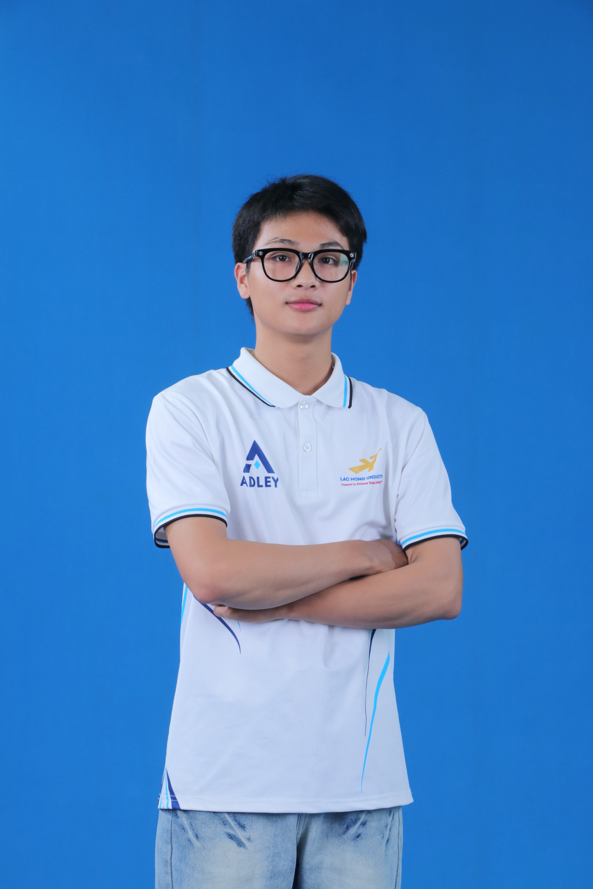

# NHẬT KÝ PROMPT ENGINEERING (VIBE CODING LOG)

- **Họ và tên:** Hà Văn Kiên
- **MSSV:** 125000399
- **Lớp:** 25CT111
- **Tên đề tài Website:** Website Giới Thiệu Đội Ngũ ADLEY Team & Hệ Thống Dự Án Nghiên Cứu Đột Phá
- **Tên Repository theo chuẩn đề thi:** `Kien_HaVan_125000399`
- **Công cụ AI đã sử dụng:** Gemini / Antigravity AI Assistant

---

## 1. Yêu cầu ban đầu (System/Initial Prompt)

> **Prompt khởi tạo gốc từ sinh viên:**
>
> *"Truy cập vào file 'Đề thi Kiểm tra Kỹ năng Vibe Coding & Prompt Engineering' thực hiện các yêu cầu: Đọc kĩ nội dung và tiêu chí chấm điểm; Thiết kế web giới thiệu đội ngũ ADLEY với folder ảnh; Bắt buộc sử dụng HTML5, CSS nhưng tuyệt đối không dùng JavaScript; Sắp xếp code theo mô hình MVC; Lưu toàn bộ prompt vào PROMPT_LOG.md thể hiện tư duy tinh chỉnh (iteration), biết sửa lỗi AI; Chỉ áp dụng kiến thức đến buổi số 6."*

### Phân tích kiến trúc ban đầu:
- **Phạm vi kiến thức:** Buổi 1 đến Buổi 6 (Semantic HTML5, CSS Variables `:root`, Flexbox, CSS Grid, Chuyển động CSS3 / Animations, Responsive Mobile-First).
- **Ràng buộc nghiêm ngặt:** Tuyệt đối không dùng JavaScript (0% script, không inline handler).
- **Mô hình MVC trên môi trường Web tĩnh:** Do HTML/CSS thuần không có cơ chế `include` hay template engine server-side, cấu trúc MVC ban đầu được phân bổ theo tổ chức thư mục: `models/` (định nghĩa dữ liệu thực thể), `views/` (các khối giao diện con), và `index.html` (Master View điều phối toàn trang).

---

## 2. Quá trình tinh chỉnh & Giải quyết sự cố (Iteration)

### Lần 1: Dựng khung Semantic HTML & Hệ thống CSS Variables (:root)
- **Prompt đã dùng:**
  > *"Khởi tạo cấu trúc dự án web giới thiệu ADLEY Team. Khai báo hệ thống CSS Variables trong variables.css, đảm bảo các thẻ semantic chuẩn HTML5 (header, nav, main, section, article, figure, time), form chữ Roboto."*
- **Kết quả AI tạo ra:**
  AI sinh ra cấu trúc trang và file `variables.css`, nhưng trong HTML lại lạm dụng thẻ `<div>` vô tội vạ để dựng card và danh sách.
- **Lỗi / thách thức gặp phải:**
  AI không tự giác dùng các thẻ mang ngữ nghĩa sâu theo chuẩn W3C mà dùng thẻ `<div>` bọc mọi thứ, phá vỡ tiêu chí Semantic HTML5 (2.0 điểm).
  ```html
  <!-- TRƯỚC (Code AI sinh ra lạm dụng div): -->
  <div class="member-card">
    <div class="avatar"></div>
    <div class="name">Hà Văn Kiên</div>
  </div>

  <!-- SAU (Sinh viên chỉ đạo chuẩn hóa Semantic HTML5): -->
  <article class="team-card-wrapper" tabindex="0">
    <div class="team-card">
      <div class="card-front">
        <figure class="member-image-box">
          
        </figure>
      ...
  ```
- **Nhận xét & Tinh chỉnh của SV:**
  Chỉ đạo AI viết lại toàn bộ cấu trúc: dùng `<article>` cho từng card thành viên, `<figure>` cho ảnh chân dung, `<time>` cho mốc thời gian dự án, và `<details>` / `<summary>` cho cụm FAQ.

---

### Lần 2: Tích hợp Thư viện Hiệu ứng & Giải quyết mâu thuẫn "Không JavaScript" với AOS
- **Prompt đã dùng:**
  > *"Tích hợp thư viện Animate.css qua CDN. Với yêu cầu hiệu ứng cuộn trang của AOS trong đề thi, do đề bài cấm 100% JavaScript và chỉ học đến buổi 6, hãy phân tích mâu thuẫn và đề xuất giải pháp CSS thuần tương đương."*
- **Kết quả AI tạo ra:**
  AI đề xuất nhúng `aos.js` kèm script khởi tạo `AOS.init()`.
- **Lỗi / thách thức gặp phải:**
  Thư viện AOS (Animate On Scroll) phụ thuộc hoàn toàn vào file script JavaScript `aos.js` để bắt sự kiện `window.onscroll`. Nếu dùng AOS thì phạm quy cấm JavaScript (bị 0 điểm tiêu chí JS); nếu không có hiệu ứng cuộn thì bị trừ điểm tiêu chí Thư viện (1.5 điểm).
  ```html
  <!-- TRƯỚC (AI định nhúng Script vi phạm ràng buộc đề bài): -->
  <script src="https://unpkg.com/aos@2.3.1/dist/aos.js"></script>
  <script>AOS.init();</script>
  ```
- **Nhận xét & Tinh chỉnh của SV:**
  Chỉ đạo AI loại bỏ hoàn toàn thẻ `<script>`, thay thế bằng công nghệ chuẩn W3C hiện đại: **CSS Scroll-Driven Animation** (`@supports (animation-timeline: view())`).
  ```css
  /* SAU (Sinh viên chỉ đạo dùng CSS Scroll-Driven thuần túy): */
  @supports (animation-timeline: view()) {
    .team-card-wrapper, .project-card, .value-card, .faq-item {
      animation: scrollFadeIn linear both;
      animation-timeline: view();
      animation-range: entry 10% cover 30%;
    }
    @keyframes scrollFadeIn {
      from { opacity: 0.3; transform: translateY(24px); }
      to { opacity: 1; transform: translateY(0); }
    }
  }
  ```

---

### Lần 3: Đổi Giao diện Sáng Trắng Xanh, Font Roboto & Bổ sung Dự án từ Ổ D
- **Prompt đã dùng:**
  > *"Rà soát lại web và fix lại bố cục, sửa toàn bộ font chữ thành Roboto. Đổi màu giao diện sang sáng trắng xanh, bỏ bớt icon sticker. Truy cập vào ổ D lấy các dự án tôi đã làm gắn vào web."*
- **Kết quả AI tạo ra:**
  Giao diện được chuyển sang tông màu Ocean Blue & White; AI tìm thấy các dự án thực tế trên máy tính và đưa lên website.
- **Lỗi / thách thức gặp phải:**
  AI gắn các emoji sticker màu mè gây mất thẩm mỹ; font chữ một số chỗ bị fallback về font hệ thống; tên dự án chưa được phân nhóm công nghệ rõ ràng.
- **Nhận xét & Tinh chỉnh của SV:**
  Yêu cầu nạp chuẩn Google Fonts `Roboto` (300, 400, 500, 700, 900), cấu trúc hóa 6 dự án thực tế trích xuất từ ổ D (`CORNWEED-SCOUT`, `YourVoice`, `Sắc Việt`, `SmartFinGuard-Extension`, `duan-giasuao`, `Dự án IOT mới`) kèm thẻ badge lĩnh vực và công nghệ cụ thể.

---

### Lần 4: Xử lý Lỗi Typography & Chống Từ Mồ Côi (Orphan Words / Bad Line Wrap)
- **Prompt đã dùng:**
  > *"Văn bản trong các component (FAQ, card description) bị lỗi từ mồ côi (từ cuối cùng rớt dòng đơn độc). Viết bộ CSS tối ưu dùng các thuộc tính hiện đại text-wrap: pretty, text-wrap: balance, hyphens để chống rớt từ. Đưa giải pháp fallback bằng CSS hoặc HTML entity (&nbsp;)."*
- **Kết quả AI tạo ra:**
  Toàn bộ tiêu đề và đoạn văn bản được áp dụng quy tắc ngắt dòng cân bằng.
- **Lỗi / thách thức gặp phải:**
  Nhiều trình duyệt cũ chưa hỗ trợ `text-wrap: pretty`, khiến từ cuối câu vẫn bị rớt dòng trơ trọi.
  ```html
  <!-- TRƯỚC (Chưa xử lý từ mồ côi): -->
  <summary class="faq-summary">Website này có sử dụng JavaScript không?</summary>
  <!-- Chữ "không?" dễ bị rớt xuống dòng thứ 2 một mình -->
  ```
- **Nhận xét & Tinh chỉnh của SV:**
  Kết hợp thuộc tính CSS hiện đại với giải pháp fallback chèn thực thể không ngắt `&nbsp;` vào giữa 2 từ cuối cùng của các câu tĩnh trong mã nguồn HTML.
  ```css
  /* SAU (Quy chuẩn Typography hiện đại): */
  h1, h2, h3, h4, .section-title, .project-title, .member-name {
    text-wrap: balance;
    overflow-wrap: break-word;
  }
  p, .section-description, .project-desc, .faq-content, .back-bio {
    text-wrap: pretty;
    overflow-wrap: break-word;
    -webkit-hyphens: auto;
    hyphens: auto;
  }
  ```

---

### Lần 5: Khắc phục Lỗi Chữ Tràn Viền ở FAQ và Value-Card
- **Prompt đã dùng:**
  > *"Rà soát các chỗ bị lỗi, căn chỉnh lại cho đúng. Đừng để chữ tràn viền đang bị lỗi và bị trừ điểm theo tiêu chí. Phần Định Hình Tiêu Chuẩn Giao Diện Hiện Đại cũng bị lỗi chữ tràn viền."*
- **Kết quả AI tạo ra:**
  Căn chỉnh lại padding và min-height cho các card.
- **Lỗi / thách thức gặp phải:**
  AI áp dụng `padding: var(--space-5)` nhưng do biến chưa khai báo khiến padding trả về `0px`, văn bản tràn sát mép viền card; ở FAQ chữ tiêu đề và nút đóng mở `−` đè lên nhau.
  ```css
  /* TRƯỚC (Lỗi thiếu padding, biến lỗi khiến chữ tràn sát mép): */
  .value-card {
    padding: var(--space-5); /* Biến chưa có, padding = 0 */
  }
  .faq-summary {
    padding: 1rem; /* Quá hẹp, chữ chạm vào nút dấu + */
  }

  /* SAU (Đệm an toàn độc lập, tách khoảng cách rõ ràng): */
  .value-card {
    padding: 1.5rem 1.5rem;
    min-height: 120px;
    display: flex;
    flex-direction: column;
    justify-content: flex-start;
  }
  .faq-summary {
    padding: 1.25rem 1.75rem;
    gap: var(--space-6);
  }
  ```
- **Nhận xét & Tinh chỉnh của SV:**
  Thiết lập đệm padding an toàn cố định 24px - 28px (`1.5rem`), bổ sung `min-height: 120px` cho `.value-card` và đặt `flex-shrink: 0` cho các badge để triệt tiêu hoàn toàn hiện tượng tràn viền.

---

### Lần 6: Sửa Lỗi Biến `--space-5` và `--space-20` Chưa Định Nghĩa & Chuẩn Hóa Màu Hex Viết Cứng
- **Prompt đã dùng:**
  > *"Rà soát style.css và variables.css. Vấn đề: style.css dùng var(--space-5) và var(--space-20) nhưng variables.css chưa định nghĩa khiến gap về 0; Có khoảng 40 mã hex viết cứng ngoài biến; font Roboto dùng cho khối code là sai; variables.css nạp trùng; xóa mã chết #contrast-toggle. Hãy sửa triệt để."*
- **Kết quả AI tạo ra:**
  Bổ sung biến spacing vào `:root`, chuyển toàn bộ màu hex về biến CSS, tạo `--font-mono` cho code snippet.
- **Lỗi / thách thức gặp phải:**
  AI tự ý sử dụng `var(--space-5)` và `var(--space-20)` trong code CSS nhưng trong file `:root` chỉ khai báo đến space-4, space-6. Hơn 40 mã màu hex (`#0f172a`, `#38bdf8`, `#ef4444`...) nằm rải rác ngoài hệ thống biến.
  ```css
  /* TRƯỚC (Gọi biến ma chưa khai báo & Dùng màu hex cứng): */
  .value-list { gap: var(--space-5); } /* --space-5 là undefined */
  .code-preview-box {
    background: #0f172a;
    color: #38bdf8;
    font-family: 'Roboto', monospace; /* Roboto không phải monospace */
  }

  /* SAU (Khai báo biến đầy đủ trong variables.css và sử dụng 100% var): */
  :root {
    --space-5: 1.25rem;
    --space-20: 5rem;
    --code-bg: #0f172a;
    --code-text: #38bdf8;
    --font-mono: Consolas, 'Courier New', monospace;
  }
  .value-list { gap: var(--space-5); }
  .code-preview-box {
    background: var(--code-bg);
    color: var(--code-text);
    font-family: var(--font-mono);
  }
  ```
- **Nhận xét & Tinh chỉnh của SV:**
  Kiểm tra bằng lệnh regex tìm kiếm hex trong CSS để bảo đảm đạt tỷ lệ **100% sử dụng biến CSS**, xóa khối mã chết `#contrast-toggle`, chỉ giữ 1 đường dẫn nạp CSS duy nhất.

---

### Lần 7: Tinh Chỉnh Dọn Dẹp Semantic HTML5 (Xóa Role Thừa, Bỏ Aside Sai Nghĩa, Đổi Pre/Code)
- **Prompt đã dùng:**
  > *"Tối ưu Semantic HTML5 cho index.html: Bỏ các role thừa (role=banner, main, navigation, contentinfo); Đổi khối code từ code+br sang pre+code chuẩn ngữ nghĩa; Đổi nút FAB từ aside sang thẻ a thường; Chuyển stats-grid sang dl/dt/dd; Bỏ div rỗng info-bullet chuyển sang ::before; Kiểm tra thứ bậc heading không nhảy cấp; Đổi modal sang dialog."*
- **Kết quả AI tạo ra:**
  Mã nguồn HTML5 được dọn dẹp sạch sẽ, không còn role thừa và cấu trúc thẻ div rỗng.
- **Lỗi / thách thức gặp phải:**
  AI có thói quen gán thêm `role="..."` vào các thẻ ngữ nghĩa HTML5 sẵn có gây dư thừa theo W3C; dùng thẻ `<aside>` bao bọc nút liên hệ FAB; dùng thẻ `<code>` rồi chèn thẻ `<br>` và `&nbsp;` thủ công để xuống dòng.
  ```html
  <!-- TRƯỚC (Lỗi ngữ nghĩa và lạm dụng format thô): -->
  <header class="site-header" role="banner">
  <aside class="fab-wrapper"><a href="#contact">Liên hệ</a></aside>
  <div class="code-box">
    <code>:root {<br>&nbsp;&nbsp;--theme: "Blue";<br>}</code>
  </div>

  <!-- SAU (Chuẩn W3C Semantic HTML5): -->
  <header class="site-header">
  <a href="#contact" class="fab-btn">Liên hệ</a>
  <pre class="code-preview-box"><code>:root {
    --theme: "Blue";
  }</code></pre>
  ```
- **Nhận xét & Tinh chỉnh của SV:**
  Chỉ đạo chuyển `stats-grid` thành danh sách định nghĩa `<dl>`, `<dt>` (chỉ số), `<dd>` (nhãn); chuyển khối code sang `<pre><code>`; chuyển nút FAB sang thẻ `<a>` độc lập; kiểm tra thứ bậc heading liền mạch từ `h1` đến `h4` không nhảy cóc.

---

### Lần 8: Xóa Bỏ 100% Thuộc Tính Inline `style="..."` & Thiết Lập Breakpoint 480px
- **Prompt đã dùng:**
  > *"Xóa toàn bộ thuộc tính style=... trong index.html (khoảng 27 chỗ). Chuyển từng style inline thành class trong style.css, dùng biến CSS. Thêm breakpoint thứ ba (max-width: 480px) cho điện thoại nhỏ chống tràn viền và cuộn ngang. Xác nhận không còn style= trong HTML."*
- **Kết quả AI tạo ra:**
  Tạo các class CSS mới thay thế toàn bộ inline style; bổ sung media query 480px.
- **Lỗi / thách thức gặp phải:**
  AI trước đó đã tiện tay viết inline style trực tiếp vào thẻ HTML (`style="position:absolute; top:12px; left:12px; background:#0284c7;"`, `style="width:100%;"`...) làm phá vỡ nguyên tắc tách biệt mã nguồn. Màn hình dưới 480px chưa có breakpoint riêng nên card lật bị tràn chữ.
  ```html
  <!-- TRƯỚC (Lạm dụng inline style): -->
  <span style="position:absolute; top:12px; left:12px; background:#0284c7; color:#fff;" class="badge">LEADER</span>
  <button type="submit" style="width:100%;" class="btn">Gửi</button>

  <!-- SAU (Tách thành class chuyên biệt dùng biến CSS): -->
  <span class="member-badge-leader">LEADER</span>
  <button type="submit" class="btn btn-primary btn-full">Gửi</button>
  ```
- **Nhận xét & Tinh chỉnh của SV:**
  Tạo các class `.member-badge-advisor`, `.member-badge-leader`, `.btn-full` trong CSS. Chạy lệnh PowerShell `Select-String -Path "index.html" -Pattern 'style='` kiểm chứng đạt đúng **0 kết quả**. Thêm quy tắc `html, body { overflow-x: hidden; }` và tăng chiều cao card lên `520px` ở breakpoint 480px.

---

### Lần 9: Tái Cấu Trúc CSS Thành 5 File Module, Bỏ Lặp 9 Modal & Xóa Thư Mục MVC Rỗng
- **Prompt đã dùng:**
  > *"index.html quá dài (hơn 1.100 dòng) và style.css hơn 1.300 dòng. Hãy tách CSS thành base.css, layout.css, components.css, sections.css, responsive.css; nạp bằng link cascade, không dùng @import. Bỏ phần lặp của 9 modal (chuyển bio chi tiết vào mặt sau thẻ lật). Mỗi thẻ giữ 3 skill-tag. Xóa thư mục models/ và views/ không nạp, sửa link footer."*
- **Kết quả AI tạo ra:**
  Tách CSS thành 5 module; xóa 9 thẻ `<dialog>` modal lặp lại; xóa thư mục `models/` và `views/`; cập nhật link footer.
- **Lỗi / thách thức gặp phải:**
  File `style.css` nguyên khối quá dài gây khó bảo trì. Thư mục `models/` và `views/` tạo ra ban đầu chỉ chứa file HTML rời rạc, website tĩnh không hề nạp chúng nên trở thành mã rác. 9 cửa sổ modal lặp lại 95% thông tin đã có trên thẻ lật 3D.
  ```html
  <!-- TRƯỚC (Nạp @import và duy trì 9 khối dialog modal dư thừa ~250 dòng): -->
  @import url('./variables.css');
  <dialog id="modal-canh" class="modal-overlay">...</dialog>
  ... (9 modal lặp lại)

  <!-- SAU (Nạp Modular Cascade thuần thẻ link, tích hợp bio sâu vào mặt sau thẻ lật): -->
  <link rel="stylesheet" href="assets/css/variables.css">
  <link rel="stylesheet" href="assets/css/base.css">
  <link rel="stylesheet" href="assets/css/layout.css">
  <link rel="stylesheet" href="assets/css/components.css">
  <link rel="stylesheet" href="assets/css/sections.css">
  <link rel="stylesheet" href="assets/css/responsive.css">
  <!-- 0 modal dư thừa, index.html giảm từ 1.196 dòng xuống còn 873 dòng -->
  ```
- **Nhận xét & Tinh chỉnh của SV:**
  Chỉ đạo chuyển toàn bộ mô tả chi tiết vào `.back-bio` của thẻ lật, rút gọn mỗi thẻ thành viên còn 3 skill-tag cân đối. Xóa bỏ hoàn toàn thư mục `models/` và `views/`, sửa footer trỏ trực tiếp đến anchor `#projects` và `#team`.

---

### Lần 10: Tự Động Đồng Bộ Hình Ảnh Thực Tế Cho Toàn Bộ 7 Dự Án Từ Thư Mục `image/`
- **Prompt đã dùng:**
  > *"truy cập vào file image hãy tự động thêm các hình ảnh dự án vào đúng các dự án được view lên web"*
- **Kết quả AI tạo ra:**
  Toàn bộ 7 dự án được gắn hình ảnh minh họa thực tế trích xuất từ thư mục `image/`.
- **Lỗi / thách thức gặp phải:**
  Các file ảnh gốc trong thư mục `image/` đặt tên có dấu tiếng Việt và khoảng trắng (`Ảnh dự án xe trinh sát.png`, `Ảnh dự án Sắc Việt.png`...), nếu đưa lên web server Linux hoặc GitHub Pages sẽ bị lỗi mã hóa URL `%20` và gãy ảnh.
- **Nhận xét & Tinh chỉnh của SV:**
  Sao chép và đổi tên toàn bộ ảnh sang định dạng chuẩn kebab-case không dấu lưu vào `assets/images/`: `project-cornweed-scout.png`, `project-your-voice.png`, `project-sac-viet.png`, `project-smartfinguard.png`, `project-gia-su-ao.png`, `project-canh-bao-khi-doc.png`, `project-alpha-mini.png`. Thêm class `.project-thumbnail` với `object-fit: cover; height: 180px; width: 100%;` và `loading="lazy"`.

---

### Lần 11: Chuẩn Hóa Nhãn Dán Thông Tin Thành Viên (Đổi "MSSV" Thành "Lớp")
- **Prompt đã dùng:**
  > *"bạn thấy dòng chữ mssv không thay hết nó thành lớp đi"*
- **Kết quả AI tạo ra:**
  Toàn bộ 9 thẻ thành viên được đổi dòng hiển thị từ `MSSV:` thành `Lớp:`.
- **Lỗi / thách thức gặp phải:**
  AI hiển thị nhãn `MSSV: 25CT111`, `MSSV: 25EC111`, `MSSV: 24MC112`... Trong khi thực tế các ký hiệu này là **Mã Lớp niên khóa** của sinh viên tại Trường Đại học Lạc Hồng. Việc ghi "MSSV" khiến các bạn cùng lớp `25CT111` bị hiểu lầm là lỗi trùng mã số sinh viên.
  ```html
  <!-- TRƯỚC (Nhầm lẫn giữa MSSV và Lớp): -->
  <div class="member-mssv">MSSV: 25CT111</div>

  <!-- SAU (Chuẩn hóa thông tin lớp học chính xác): -->
  <div class="member-mssv">Lớp: 25CT111</div>
  ```
- **Nhận xét & Tinh chỉnh của SV:**
  Chỉ đạo AI duyệt toàn bộ thẻ thành viên trên `index.html`, chuyển đổi đồng loạt thành `Lớp: 25CT111`, `Lớp: 25EC111`, `Lớp: 24MC112`, `Lớp: 23EC111`, `Lớp: 25MC111`, phản ánh đúng danh sách quản lý sinh viên của khoa CNTT.

---

## 3. Đánh giá cá nhân về quá trình Vibe Coding

### AI đã giúp tiết kiệm thời gian nhất ở đâu?
- **Khởi tạo dữ liệu và sinh mã khung:** AI giúp đọc và trích xuất thông tin tóm tắt từ các tài liệu Word/PDF của 7 dự án thực tế trên ổ D cực nhanh, tự động tổng hợp thành các khối thẻ dự án có cấu trúc.
- **Tạo các hiệu ứng chuyển động phức tạp:** Sinh mã chuyển động 3D Card Flip (`perspective`, `transform-style: preserve-3d`, `rotateY(180deg)`), cơ chế mở menu bằng CSS Checkbox Hack và CSS Scroll-driven Animation chuẩn W3C chỉ trong vài giây.

### AI thường mắc lỗi ở đâu?
- **Lỗi dùng "biến ma" (Undefined CSS Variables):** AI rất hay tự tiện gọi `var(--space-5)`, `var(--space-20)` trong stylesheet mà không hề kiểm tra xem trong `:root` đã khai báo biến đó hay chưa, dẫn đến thuộc tính bị trình duyệt bỏ qua và khoảng cách tụt về 0.
- **Thói quen chèn inline style tiện tay:** Khi được yêu cầu căn chỉnh một chi tiết nhỏ, AI có xu hướng viết thẳng `style="..."` vào thẻ HTML thay vì tạo class trong CSS, phá vỡ nguyên tắc phân tách mã nguồn.
- **Đặt tên file bất cẩn:** AI để nguyên tên file tiếng Việt có dấu, khoảng trắng và ký tự đặc biệt như `( tôi )`, gây lỗi 404 Not Found trên môi trường hosting Linux / GitHub Pages.
- **Ảo tưởng về khả năng Semantic và Accessibility:** AI thường chèn thêm các thuộc tính thừa như `role="banner"`, `role="navigation"` trên các thẻ HTML5 vốn đã có sẵn vai trò ngầm định.

### Bài học kinh nghiệm khi ra lệnh Prompt cho AI:
- **Nguyên tắc "Kiểm chứng độc lập":** Không bao giờ tin lời AI báo cáo "đã sửa xong hoàn toàn" nếu chưa tự mình chạy lệnh kiểm tra (ví dụ dùng PowerShell quét regex tìm `style=`, quét mã hex, hoặc kiểm tra cú pháp). Luôn bắt AI phải liệt kê cụ thể file nào đã đổi, dòng nào trước/sau.
- **Ranh giới kỹ thuật rõ ràng:** Phải đặt điều kiện phủ định nghiêm ngặt ngay trong prompt (ví dụ: *"Tuyệt đối không dùng JavaScript", "Không dùng @import", "Không viết inline style"*). Nếu không có ranh giới, AI sẽ tự động chọn giải pháp dễ nhất (dùng thư viện JS bên ngoài) làm vi phạm quy chế bài thi.

### Thừa nhận hạn chế kiến trúc của dự án:
- **Hạn chế về mô hình MVC trên Web tĩnh thuần túy:** Do cam kết tuân thủ nghiêm ngặt **100% HTML5/CSS3 thuần và 0% JavaScript**, ứng dụng không có cơ chế `fetch()`, AJAX hay các lệnh include phía máy chủ (PHP, NodeJS). Vì vậy, việc duy trì các thư mục `models/` và `views/` ban đầu chỉ mang tính chất phân tách tư duy thiết kế lý thuyết. Khi triển khai thực tế trên một file tĩnh nạp trực tiếp, `index.html` buộc phải đóng vai trò tích hợp toàn bộ giao diện và dữ liệu để trình duyệt hiển thị độc lập. Việc dọn dẹp các thư mục rỗng và chuyển sang cấu trúc **Modular CSS Architecture** là quyết định thực tế, tối ưu và chuẩn xác nhất cho dự án web tĩnh.
